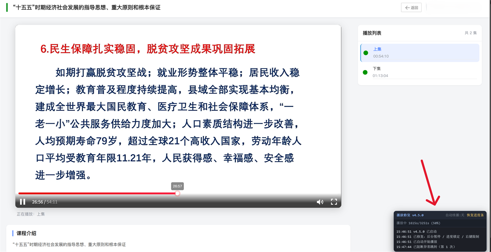
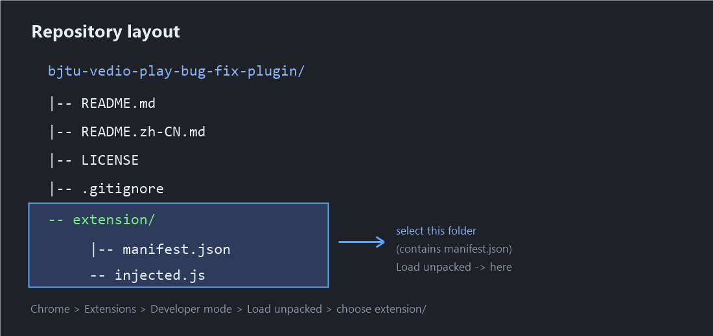
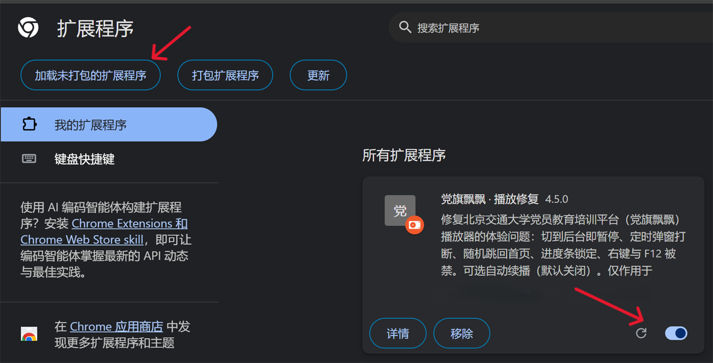
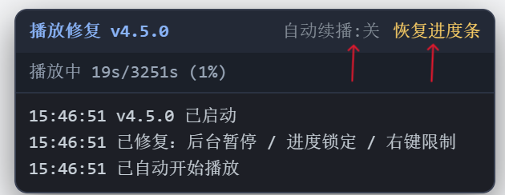

# 党旗飘飘 · 播放修复

**English** | [简体中文](README.zh-CN.md)

A small browser extension that fixes the playback problems on the Beijing Jiaotong
University (BJTU) Party education platform — 「党旗飘飘」, `jjfzpx.bjtu.edu.cn`.



---

## Why this exists

While working through the required online course, we kept running into the same two
problems: the player **pauses on its own**, and it **jumps the page away at irregular
intervals**. Neither has anything to do with the course content, but both happen often
enough to constantly break concentration — a lecture that should play straight through
ends up chopped into a dozen fragments.

Digging into the player (`xgplayer-p2p`) showed that these interruptions come from a set
of segmented-playback and state-checking options. Their trigger conditions do not line up
well with whether someone is actually watching, so in practice they fire when they
shouldn't.

So we wrote this extension to do one thing: **remove those unintended interruptions**, so
a video can play through without being cut off.

## What it fixes

| What you see | Where it comes from |
| --- | --- |
| Video pauses the moment you switch tabs or minimize the window | `pauseOnHidden: true` |
| "视频已暂停，点击按钮后继续学习！" pops up every few minutes | `loopPause` with a 5-minute interval |
| Page randomly jumps back to the course list while watching | a 53-second poll of `/ybdy/play/check_multiple` that navigates away when it gets an unexpected reply |
| Seek bar is locked, you cannot go back or re-watch | `seekGuard: no-forward` |
| A 「继续观看 · 该视频已播放至 …」 dialog blocks playback on partially-watched videos | the player's built-in confirm dialog |
| "休息一下" reminder interrupts long sessions | the built-in break reminder |
| F12 / right-click / Ctrl+U are disabled | keyboard and context-menu interception |

## What it does and does not do

**Does**

- Keeps the video playing when you switch tabs or minimize the window
- Closes the interruption prompts that break up a lesson
- Prevents the page from being thrown back to the course list mid-video
- Remembers where you stopped and resumes from there
- Restores the ability to seek within what you have already watched
- *Optional, off by default:* auto-advance to the next segment when one finishes

**Does not**

- Modify, fake, or accelerate the platform's study-time accounting
- Simulate watching — every second is played in real time
- Skip content: even auto-advance only fires after a segment truly ends
- Touch any site other than `jjfzpx.bjtu.edu.cn`

## Install

**1. Get the files**

```bash
git clone https://github.com/yihui504/bjtu-video-play-bug-fix-plugin.git
```

Or use **Code → Download ZIP** and unzip it. The layout looks like this:



**2. Open the extensions page**

Type `chrome://extensions` in the address bar (or `edge://extensions` in Edge):



*The red arrows mark the two buttons you need: **加载未打包的扩展程序 / Load unpacked** at
the top, and the reload icon on the extension card (used after updating the files).*

**3. Turn on Developer mode**

Toggle **开发者模式 / Developer mode** in the top-right corner.

**4. Click 加载未打包的扩展程序 / Load unpacked**

In the folder picker, choose the **`extension/`** folder — the one that contains
`manifest.json`, **not** the repository root.

**5. Open the course page and play a video**

The extension only runs on `jjfzpx.bjtu.edu.cn`. The panel appears in the bottom-right
corner once a video page is loaded.

> The extension's on-screen panel is in Chinese, since its users are Chinese-speaking
> students.

## Usage



*The arrows point at the two controls described below.*

The panel has two controls in its title bar:

| Control | Meaning |
| --- | --- |
| **自动续播: 开 / 关** | Optional auto-advance to the next segment. **Off by default.** Your choice is remembered. |
| **恢复进度条** | If the player re-locks the seek bar after a while, click this to unlock it again. |

Everything else is automatic — no configuration needed. Click the title bar to collapse
or expand the log.

## FAQ

**The video is muted after switching to the next one.**
Browsers block audio autoplay on pages the user did not click on. The extension falls
back to muted playback so the video keeps running, then tries to restore sound. If it is
still muted, click the video once.

**Does this change my study time or progress?**
No. The video is played in real time and progress is reported to the server exactly as
before. The extension only changes playback behaviour in the browser.

**The platform was updated and it stopped working.**
This extension targets the current configuration of `xgplayer-p2p` on this specific site.
If the player changes, the options it relies on may disappear. Open an issue with the
panel log and we will take a look.

**Do I need Tampermonkey?**
No. Uninstall any older userscript version first — running both will conflict.

## Compatibility

- Chrome / Edge (Manifest V3), desktop
- Only `jjfzpx.bjtu.edu.cn`
- Firefox and mobile browsers are not tested

## Disclaimer

This is an independent, unofficial project. It is not affiliated with, endorsed by, or
supported by Beijing Jiaotong University or the operator of the 「党旗飘飘」platform.

- **For personal study and technical research only.** The source is published so others
  can see how the `xgplayer-p2p` player behaves in a real browser environment.
- **It does not shorten anything.** This extension never alters, fakes, accelerates, or
  skips the platform's study-time accounting. Videos are still played at normal speed,
  progress is still reported to the server as usual, and the required watching time is
  unchanged.
- **No warranty.** The platform may change at any time; the extension may stop working or
  behave unexpectedly. The author accepts no liability for any consequence of use,
  including account restrictions or academic penalties.
- **Your responsibility.** By installing this extension you agree to comply with your
  institution's rules and the platform's terms of service. If those rules explicitly state
  that using a tool to remove these pauses and jumps counts as cheating, please follow
  those rules and do not use it.

## License

[MIT](LICENSE)
