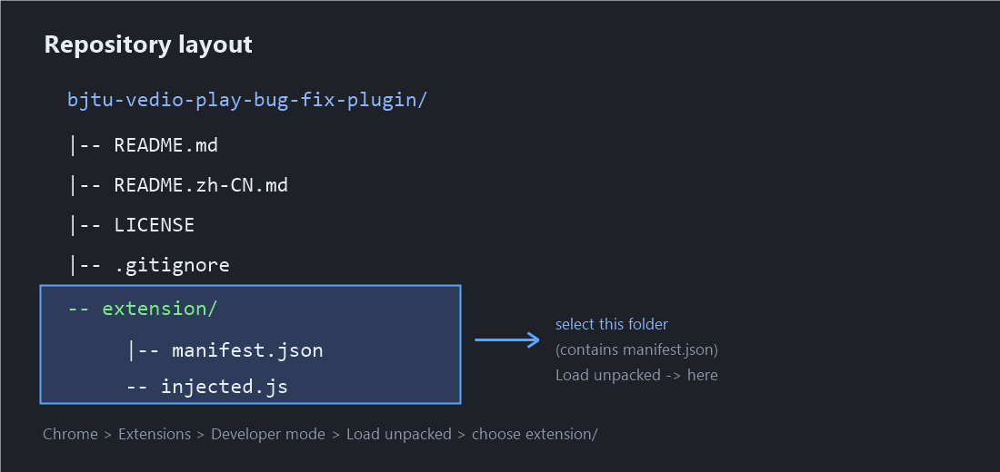
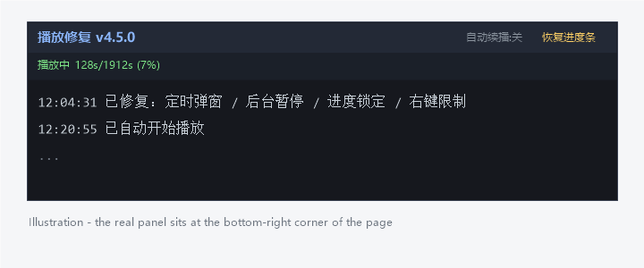

# 党旗飘飘 · 播放修复

[English](README.md) | **简体中文**

一个浏览器扩展，用于修复北京交通大学党员教育培训平台（「党旗飘飘」，
`jjfzpx.bjtu.edu.cn`）播放器的体验问题。

---

## 项目缘起

在使用本平台完成线上课程时，我们反复遇到同一个问题：播放器会**不定时自行暂停，
并把页面跳到别处**。这两件事都和课程内容无关，但出现得足够频繁，足以不断打断专注
——一节本该顺下来看完的课，被切成了十几段。

排查播放器（`xgplayer-p2p`）后发现，这些打断来自一组分段播放与状态检测配置。它们
的触发条件与「是否真的在看」并不一致，因此在实际使用中经常误触发。

于是我们写了这个扩展，只做一件事：**消除这些非预期的打断**，让视频能连续播完。

## 修复的问题

| 你看到的现象 | 来源 |
| --- | --- |
| 切标签页或最小化窗口，视频立刻暂停 | `pauseOnHidden: true` |
| 每隔几分钟弹出「视频已暂停，点击按钮后继续学习！」 | `loopPause`，间隔 5 分钟 |
| 看着看着页面突然跳回课程列表 | 每 53 秒轮询 `/ybdy/play/check_multiple`，返回异常时就跳转离开 |
| 进度条被锁死，不能回看 | `seekGuard: no-forward` |
| 播放到一半时弹出「继续观看 · 该视频已播放至 …」，挡住播放 | 播放器内置确认弹框 |
| 长时间观看被「休息一下」提示打断 | 内置休息提醒 |
| F12、右键、Ctrl+U 被禁用 | 键盘与右键拦截 |

## 这个扩展做什么 / 不做什么

**做**

- 切标签页、最小化窗口时保持播放
- 自动关闭打断学习的提示框
- 避免播放中途被跳回课程列表
- 记住上次位置，从断点继续
- 恢复在已观看范围内拖动进度条的能力
- *可选，默认关闭：* 一节播完后自动进入下一节

**不做**

- 不修改、伪造或加速平台的学时统计
- 不模拟观看——每一秒都是真实播放
- 不跳过内容：即使自动续播，也要等一节真正播完
- 不作用于 `jjfzpx.bjtu.edu.cn` 之外的任何网站

## 安装

**1. 获取文件**

```bash
git clone https://github.com/yihui504/bjtu-vedio-play-bug-fix-plugin.git
```

或者在仓库页点 **Code → Download ZIP** 后解压。目录结构如下：



**2. 打开扩展管理页**

地址栏输入 `chrome://extensions`（Edge 为 `edge://extensions`）：


**3. 打开开发者模式**

点击右上角的 **开发者模式** 开关。

**4. 点击「加载未打包的扩展程序」**

在弹出的文件夹选择框中，选择 **`extension/`** 目录——即包含 `manifest.json` 的那一层，
**不是** 仓库根目录。

**5. 打开课程页并播放视频**

扩展只在 `jjfzpx.bjtu.edu.cn` 上运行。进入视频播放页后，页面右下角会出现状态面板。

## 使用说明



面板标题栏右侧有两个开关：

| 控件 | 说明 |
| --- | --- |
| **自动续播: 开 / 关** | 可选功能：一节播完后自动进入下一节。**默认关闭**，你的选择会被记住。 |
| **恢复进度条** | 若播放器过一会儿又把进度条锁上，点一下即可再次恢复。 |

其余全部自动生效，无需配置。点击标题栏可折叠或展开日志。

## 常见问题

**切换到下一节后没有声音。**
浏览器会拦截「用户未点击过的页面」的有声自动播放。扩展会先静音把视频播起来，再尝试
恢复声音。如果仍然是静音，在画面上点一下即可。

**会影响我的学习时长或进度吗？**
不会。视频按原速真实播放，进度照常上报服务器。扩展只改变浏览器内的播放行为。

**平台改版后失效了怎么办？**
本扩展针对当前 `xgplayer-p2p` 在这一个站点上的配置实现。若播放器改版，所依赖的配置项
可能消失。可以带上状态面板里的日志提一个 issue。

**需要先装油猴（Tampermonkey）吗？**
不需要。如果你装过旧版的用户脚本，请先卸载——两者同时运行会冲突。

## 兼容性

- Chrome / Edge（Manifest V3），桌面端
- 仅限 `jjfzpx.bjtu.edu.cn`
- Firefox 与移动端浏览器未测试

## 免责声明

本项目为独立、非官方项目，与北京交通大学及「党旗飘飘」平台运营方无任何隶属、认可或
支持关系。

- **仅供个人学习与技术研究。** 公开源码是为了让人了解 `xgplayer-p2p` 播放器在真实
  浏览器环境下的行为。
- **不缩短任何要求。** 本扩展不会修改、伪造、加速或跳过平台的学时统计。视频仍按原速
  播放，进度仍照常上报服务器，所需观看时长不变。
- **不作任何担保。** 平台随时可能改版，扩展可能失效或出现异常行为。作者不对使用造成
  的任何后果负责，包括账号受限或学业处罚。
- **责任自负。** 安装即表示你同意遵守所在院校规定与平台服务条款。若相关规定明示使用
  本工具解除暂停与跳转属于作弊，请自觉遵守相关规则。

## 许可证

[MIT](LICENSE)
